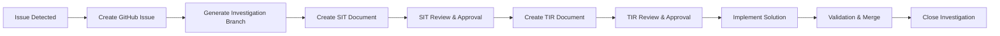

# Investigation Workflow Git Integration Guide

## Scalable Naming Convention

### File Naming Pattern
```
{investigation-type}-{YYYY-MM-DD}-{issue-category}-{brief-description}.md
```

### Investigation Types
- `system-investigation` (SIT) - Phase 1 analysis
- `technical-investigation-report` (TIR) - Phase 2 detailed analysis  

### Issue Categories
- `build-errors` - Compilation failures
- `typescript-errors` - Type system issues
- `dependency-conflicts` - Package/module issues
- `performance-issues` - Optimization problems
- `security-vulnerabilities` - Security concerns
- `configuration-problems` - Setup/config issues
- `test-failures` - Testing framework issues
- `deployment-issues` - CI/CD pipeline problems

### Git Workflow Integration

#### 1. Branch Naming Convention
```
investigation/{YYYY-MM-DD}/{issue-category}/{brief-description}
```

**Examples:**
- `investigation/2025-06-02/typescript-errors/admin-any-types`
- `investigation/2025-06-03/build-errors/dependency-conflicts`
- `investigation/2025-06-04/performance-issues/slow-queries`

#### 2. Commit Message Format
```
{phase}: {brief-description}

{investigation-id}
{optional-details}
```

**Examples:**
```
SIT: Analyze TypeScript 'any' usage in admin components

SIT-2025-06-02-001
- 6 'any' type violations identified
- Clustered in admin pages and API routes
- Recommendation: Proceed with TIR

TIR: Implement Prisma types for admin components

TIR-2025-06-02-001  
- Replace 'any' types with Prisma-generated types
- Fix React hooks dependency warnings
- Add proper type imports
```

#### 3. Pull Request Template
```markdown
## Investigation Summary
**Investigation ID:** {SIT/TIR-YYYY-MM-DD-###}
**Issue Category:** {category}
**Risk Level:** {Critical/High/Medium/Low}

## Changes Made
- [ ] SIT document created and reviewed
- [ ] TIR document created and approved  
- [ ] Technical solution implemented
- [ ] Tests pass
- [ ] Documentation updated

## Investigation Documents
- SIT: [Link to system-investigation-{name}.md]
- TIR: [Link to technical-investigation-report-{name}.md]

## Approval Checklist
- [ ] Technical Lead Review
- [ ] Project Manager Approval
- [ ] Code Review Complete
- [ ] CI/CD Pipeline Passes

## Rollback Plan
{Brief description of rollback strategy from TIR}
```

#### 4. Issue Tracking Integration
```yaml
# GitHub Issue Template: investigation-request.yml
name: Investigation Request
description: Request formal investigation using SIT/TIR workflow
labels: ["investigation", "needs-triage"]
body:
  - type: dropdown
    id: issue-category
    attributes:
      label: Issue Category
      options:
        - build-errors
        - typescript-errors  
        - dependency-conflicts
        - performance-issues
        - security-vulnerabilities
        - configuration-problems
        - test-failures
        - deployment-issues
  - type: dropdown
    id: priority
    attributes:
      label: Priority Level
      options:
        - Critical
        - High  
        - Medium
        - Low
  - type: textarea
    id: build-output
    attributes:
      label: Build Output / Error Messages
      description: Paste complete build output or error messages
      render: shell
  - type: textarea
    id: business-impact
    attributes:
      label: Business Impact
      description: Describe how this affects users, deployment, or business operations
```

### Directory Structure
```
/
├── investigations/
│   ├── 2025-06/
│   │   ├── system-investigation-2025-06-02-typescript-eslint-errors.md
│   │   ├── technical-investigation-report-2025-06-02-typescript-eslint-errors.md
│   │   ├── system-investigation-2025-06-03-build-errors-dependency-conflicts.md
│   │   └── technical-investigation-report-2025-06-03-build-errors-dependency-conflicts.md
│   ├── 2025-07/
│   └── archive/
│       └── 2024-12/
├── .github/
│   ├── ISSUE_TEMPLATE/
│   │   └── investigation-request.yml
│   └── PULL_REQUEST_TEMPLATE/
│       └── investigation-pr.md
└── investigation-workflow-guide.md
```

### Automation Opportunities

#### 1. GitHub Actions Workflow
```yaml
# .github/workflows/investigation-automation.yml
name: Investigation Workflow Automation

on:
  issues:
    types: [opened, labeled]
  
jobs:
  create-investigation-branch:
    if: contains(github.event.issue.labels.*.name, 'investigation')
    runs-on: ubuntu-latest
    steps:
      - uses: actions/checkout@v4
      - name: Create Investigation Branch
        run: |
          ISSUE_NUMBER=${{ github.event.issue.number }}
          CATEGORY=$(echo "${{ github.event.issue.body }}" | grep -A1 "Issue Category" | tail -1)
          DATE=$(date +%Y-%m-%d)
          BRANCH_NAME="investigation/${DATE}/${CATEGORY}/issue-${ISSUE_NUMBER}"
          git checkout -b "${BRANCH_NAME}"
          git push origin "${BRANCH_NAME}"
      
      - name: Create Investigation Templates
        run: |
          # Auto-generate SIT template with issue data pre-filled
          # Auto-assign to appropriate team member based on category
```

#### 2. VS Code Snippets
```json
{
  "SIT Template": {
    "prefix": "sit-template",
    "body": [
      "# System Investigation Template (SIT)",
      "**Based on IEEE 1044 Software Anomaly Classification Standards**",
      "",
      "---",
      "",
      "## Document Control",
      "| Field | Value |",
      "|-------|--------|",
      "| **Investigation ID** | SIT-${CURRENT_YEAR}-${CURRENT_MONTH}-${CURRENT_DATE}-${1:###} |",
      "| **Investigator** | ${2:Project Manager/Lead} |",
      "| **Date Created** | ${CURRENT_YEAR}-${CURRENT_MONTH}-${CURRENT_DATE} |",
      "| **Priority Level** | ${3|Critical,High,Medium,Low|} |",
      "| **Build/System** | ${4:System name and version} |",
      "| **Investigation Status** | ${5|Open,In Progress,Completed|} |"
    ],
    "description": "Create System Investigation Template"
  }
}
```

### Integration with Project Management

#### 1. Linear/Jira Integration
```javascript
// Auto-create tickets from investigation documents
const createInvestigationTicket = {
  title: `[Investigation] ${issueCategory} - ${briefDescription}`,
  description: `
    Investigation ID: ${investigationId}
    Risk Level: ${riskLevel}
    
    SIT Document: ${sitLink}
    TIR Document: ${tirLink}
    
    Timeline: ${estimatedHours} hours
    Assigned: ${assignedDeveloper}
  `,
  labels: ['investigation', issueCategory, riskLevel],
  project: 'Technical Debt',
  assignee: assignedDeveloper
}
```

#### 2. Slack Integration
```javascript
// Auto-notify team when investigations are created/completed
const slackNotification = {
  channel: '#dev-team',
  message: `
    🔍 New Investigation Started
    
    **ID:** ${investigationId}
    **Category:** ${issueCategory}
    **Risk:** ${riskLevel}
    **Assigned:** ${assignedDeveloper}
    
    📋 SIT: ${sitLink}
    📊 TIR: ${tirLink}
    
    Expected completion: ${dueDate}
  `
}
```

### Metrics and Reporting

#### 1. Investigation Dashboard
```sql
-- Sample queries for investigation metrics
SELECT 
  issue_category,
  COUNT(*) as total_investigations,
  AVG(resolution_time_hours) as avg_resolution_time,
  COUNT(CASE WHEN status = 'completed' THEN 1 END) as completed_count
FROM investigations 
WHERE created_date >= DATE_SUB(NOW(), INTERVAL 30 DAY)
GROUP BY issue_category;
```

#### 2. Success Metrics
- **Investigation Accuracy:** Root cause correctly identified
- **Timeline Adherence:** Completed within estimated time
- **Solution Effectiveness:** No recurrence of same issue
- **Process Adoption:** Team using workflow consistently

### Best Practices

#### 1. Investigation Lifecycle


#### 2. Quality Gates
- **SIT Quality Gate:** Evidence-based analysis without assumptions
- **TIR Quality Gate:** Root cause identified with concrete solution
- **Implementation Gate:** All tests pass, rollback plan tested
- **Closure Gate:** Solution validated, documentation complete

This scalable naming convention and git integration approach provides:
- **Traceability:** Clear linking between issues, investigations, and solutions
- **Automation:** Reduced manual work through GitHub Actions and templates
- **Metrics:** Data-driven insights into investigation effectiveness
- **Team Collaboration:** Standardized process for all team members