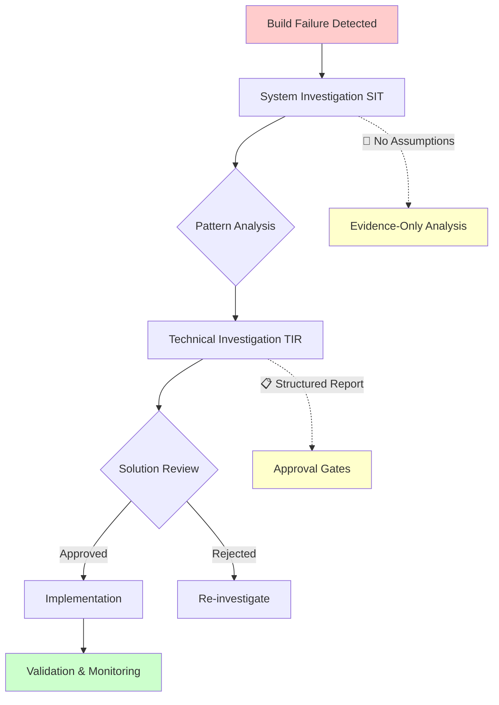

# Universal Build Investigation Workflow Guide
**Systematic Approach to Build Output Analysis**

## Overview

This workflow provides a **standardized, assumption-free methodology** for investigating build failures, compilation errors, and system anomalies. It follows industry standards (IEEE 1044, ITIL) and ensures thorough analysis before implementing solutions.

## Workflow Architecture



## Phase 1: System Investigation (SIT)

### Responsible Party
**Project Manager / Technical Lead**

### Purpose
- Analyze build output without making technical assumptions
- Identify error patterns and relationships
- Define investigation scope for developers
- Assess business risk and timeline impact

### Key Principles
1. **No Technical Assumptions:** Focus on observable patterns only
2. **Evidence-Based Analysis:** Use only data from build output
3. **Risk Assessment:** Evaluate business impact before technical solutions
4. **Scope Definition:** Define clear boundaries for developer investigation

### Template Usage
Use **System Investigation Template (SIT)** for:
- Build failures (compilation errors)
- CI/CD pipeline failures
- Dependency conflicts
- Configuration issues
- Performance anomalies

### Success Criteria
- [ ] Error patterns identified without assumptions
- [ ] Business risk assessed accurately
- [ ] Investigation scope clearly defined
- [ ] Developer assignment with specific deliverables

## Phase 2: Technical Investigation (TIR)

### Responsible Party
**Developer (Junior/Senior)**

### Purpose
- Conduct deep technical analysis based on SIT scope
- Identify root causes with evidence
- Design solutions with impact analysis
- Provide implementation plan with risk mitigation

### Key Principles
1. **Evidence Collection:** Gather actual data, not suppositions
2. **Root Cause Analysis:** Find fundamental causes, not symptoms
3. **Solution Validation:** Test approach before proposing
4. **Documentation Standards:** Provide complete technical documentation

### Template Usage
Use **Technical Investigation Report (TIR)** for:
- Code-level analysis
- Architecture investigations  
- Performance deep-dives
- Security vulnerability analysis
- Integration problem solving

### Success Criteria
- [ ] Root cause identified with concrete evidence
- [ ] Solution designed with impact analysis
- [ ] Implementation plan with timelines
- [ ] Risk mitigation and rollback strategies

## Universal Application Examples

### Example 1: TypeScript Build Errors

**SIT Phase:**
- Analyze `npm run build` output
- Identify error clustering (same files/types)
- Assess deployment risk
- Define investigation scope

**TIR Phase:**
- Examine specific error lines and context
- Investigate existing type infrastructure
- Design type safety solution
- Plan implementation with testing

### Example 2: Dependency Conflicts

**SIT Phase:**
- Analyze package resolution errors
- Map dependency tree issues
- Assess compatibility risks
- Define resolution scope

**TIR Phase:**
- Examine package.json and lock files
- Test version compatibility
- Design upgrade/downgrade strategy
- Plan migration with validation

### Example 3: Performance Degradation

**SIT Phase:**
- Analyze performance metrics
- Identify affected components
- Assess user impact
- Define optimization scope

**TIR Phase:**
- Profile application performance
- Identify bottlenecks with evidence
- Design optimization strategy
- Plan implementation with benchmarks

## Decision Framework

### When to Use SIT Only
- Simple configuration fixes
- Clear single-file issues
- Known patterns with established solutions
- Time-critical hotfixes

### When to Use SIT + TIR
- Complex multi-file issues
- Unknown or novel problems
- Architectural considerations
- High-risk production systems

### When to Escalate
- Security implications detected
- Fundamental architecture changes required
- External expertise needed
- Business-critical system impact

## Quality Gates

### SIT Quality Gates
1. **Completeness:** All build errors documented
2. **Objectivity:** No technical assumptions made
3. **Risk Assessment:** Business impact clearly defined
4. **Scope Definition:** Clear investigation boundaries

### TIR Quality Gates
1. **Evidence-Based:** Root cause supported by data
2. **Solution Validity:** Approach tested and verified
3. **Impact Analysis:** Full change impact documented
4. **Implementation Readiness:** Detailed plan with rollback

## Template Integration

### SIT Template Sections → TIR Template Sections

| SIT Section | Feeds Into TIR Section | Purpose |
|-------------|------------------------|---------|
| Error Distribution | Evidence Collection | Defines what to investigate |
| Pattern Recognition | Root Cause Analysis | Guides investigation approach |
| Risk Assessment | Impact Analysis | Sets risk context |
| Investigation Scope | Solution Design | Defines solution boundaries |

### Approval Flow

```
SIT Creation → SIT Review → TIR Assignment → TIR Creation → TIR Review → Implementation Approval → Execution
```

## Common Anti-Patterns to Avoid

### ❌ SIT Anti-Patterns
- Making technical assumptions about causes
- Proposing solutions before investigation
- Skipping risk assessment
- Undefined investigation scope

### ❌ TIR Anti-Patterns  
- Not investigating existing solutions
- Assuming missing components
- Inadequate testing strategy
- Missing rollback plans

### ✅ Best Practices
- Systematic evidence collection
- Structured documentation
- Clear approval gates
- Risk-based decision making

## Metrics and Success Indicators

### Process Metrics
- **Investigation Time:** SIT + TIR duration
- **Solution Accuracy:** Root cause correctly identified
- **Implementation Success:** Changes deployed without issues
- **Rollback Frequency:** How often rollbacks are needed

### Quality Metrics
- **Error Recurrence:** Same issues reappearing
- **Solution Completeness:** All aspects addressed
- **Documentation Quality:** Future reference value
- **Team Learning:** Knowledge transfer effectiveness

## Continuous Improvement

### Regular Review Questions
1. Are investigation times appropriate for issue complexity?
2. Are root causes being correctly identified?
3. Are solutions addressing fundamental issues?
4. Is the process improving team capabilities?

### Template Evolution
- Collect feedback from each investigation
- Update templates based on lessons learned
- Add new sections for emerging patterns
- Maintain backward compatibility

## Investigation CLI Tool

### Quick Start Commands
```bash
# Complete investigation workflow in 4 commands:
./scripts/investigate init <category> <description>
./scripts/investigate sit
./scripts/investigate tir  
./scripts/investigate complete  # Auto-push + PR creation
```

### Available Categories
- `typescript-errors` - TypeScript/ESLint issues
- `build-errors` - Compilation failures  
- `dependency-conflicts` - Package/module issues
- `performance-issues` - Optimization problems
- `security-vulnerabilities` - Security concerns
- `configuration-problems` - Setup/config issues
- `test-failures` - Testing framework issues
- `deployment-issues` - CI/CD pipeline problems

### CLI Commands Reference
| Command | Purpose | Output |
|---------|---------|---------|
| `init <category> <description>` | Creates investigation branch and metadata | Git branch + `.investigation-meta` |
| `sit` | Generates SIT document with build analysis | `investigations/YYYY-MM/system-investigation-*.md` |
| `tir` | Creates TIR template for technical analysis | `investigations/YYYY-MM/technical-investigation-report-*.md` |
| `complete` | Commits, pushes, and creates PR automatically | GitHub PR with investigation template |
| `status` | Shows current investigation progress | Status and next steps |
| `list` | Lists all investigations | All investigation documents |

---

## Phase 3: Investigation Review & Approval

### **SIT Review Process**
**Responsible Party:** Project Manager / Technical Lead

#### Review Checklist
```markdown
SIT Review Checklist:
- [ ] Error patterns identified without assumptions
- [ ] Business risk assessed accurately  
- [ ] Investigation scope clearly defined
- [ ] Developer assignment appropriate
- [ ] Timeline estimates reasonable
```

#### Review Actions
**Approve SIT:**
```markdown
✅ SIT Approved - Proceed to TIR Phase

Reviewed investigation scope and risk assessment.
Approved for technical analysis phase.

Next: Developer assigned for TIR creation
Timeline: [X hours] for technical investigation
```

**Request SIT Changes:**
```markdown
⚠️ SIT Changes Requested

Issues identified:
- [ ] Risk assessment needs clarification
- [ ] Investigation scope too broad/narrow
- [ ] Additional error analysis required

Please update SIT document and re-submit for review.
```

### **TIR Review Process**
**Responsible Party:** Technical Lead / Senior Developer

#### Review Checklist
```markdown
TIR Review Checklist:
- [ ] Root cause identified with concrete evidence
- [ ] Solution designed with impact analysis
- [ ] Implementation plan with realistic timelines
- [ ] Risk mitigation and rollback strategies
- [ ] Test strategy comprehensive
- [ ] Breaking changes documented
```

#### Review Actions
**Approve TIR:**
```markdown
✅ TIR Approved - Ready for Implementation

Technical analysis complete and solution validated.
Implementation plan approved.

Solution Summary: [Brief description]
Estimated Implementation: [X hours]
Risk Level: [Level]
Breaking Changes: [Yes/No]

Next: Create implementation ticket/assignment
```

**Request TIR Changes:**
```markdown
⚠️ TIR Changes Requested

Technical issues identified:
- [ ] Root cause analysis incomplete
- [ ] Solution approach needs refinement
- [ ] Implementation plan missing details
- [ ] Rollback strategy insufficient

Please address issues and re-submit for review.
```

---

## Phase 4: Implementation Execution

### **Implementation Strategy**

#### **Option A: Branch from Investigation**
```bash
# Recommended for complex changes
git checkout investigation/2025-06-02/typescript-errors/admin-any-types
git checkout -b feature/implement-typescript-fixes
```

#### **Option B: Fresh Implementation Branch**
```bash
# For simpler implementations
git checkout main
git checkout -b feature/fix-typescript-errors-admin-components
# Reference: Investigation SIT-2025-06-02-001
```

### **Implementation Commit Standards**
```bash
git commit -m "Implement TypeScript error fixes from investigation

Implements solution from TIR-2025-06-02-001:
- Replace 'any' types with Prisma-generated types  
- Fix React hooks dependency arrays
- Add proper type imports to admin components

Files modified:
- src/app/admin/steps/page.tsx
- src/app/api/admin/repositories/route.ts
- src/components/FounderProfiler.tsx

Investigation: #14
Testing: All existing tests pass, no breaking changes"
```

### **Implementation Validation**
```markdown
Implementation Validation Checklist:
- [ ] All TIR requirements implemented
- [ ] Build passes without errors
- [ ] All tests pass
- [ ] No performance degradation
- [ ] Rollback procedure tested
- [ ] Code review completed
- [ ] Documentation updated
```

---

## Phase 5: Investigation Closure

### **Close Investigation PR**
After implementation is deployed:

```markdown
✅ Investigation Complete - Implementation Successful

**Implementation Status:** ✅ Deployed to Production
**Implementation PR:** #16
**Deployment Date:** [Date]
**Validation Results:** All tests pass, no issues detected

**Investigation Summary:**
- Root Cause: [Brief summary]
- Solution: [Brief summary]  
- Implementation Time: [Actual vs Estimated]
- Business Impact: [Resolved issues]

**Lessons Learned:**
- [Key insights from investigation]
- [Process improvements identified]

**Status:** Closed - Successfully Implemented
**Documents Preserved:** SIT and TIR documents archived for future reference
```

### **Investigation Branch Management**

#### **Immediate Actions**
```bash
# Archive investigation for future reference
git checkout investigation/2025-06-02/typescript-errors/admin-any-types
git tag archive/investigation-2025-06-02-typescript-errors
git push origin archive/investigation-2025-06-02-typescript-errors

# Keep branch active for 30 days, then delete
# Investigation documents remain in main branch
```

#### **Long-term Archival (6+ months)**
```bash
# Archive old investigations
git branch -d investigation/2025-06-02/typescript-errors/admin-any-types
git push origin --delete investigation/2025-06-02/typescript-errors/admin-any-types

# Documents preserved in investigations/ directory on main branch
```

---

## Investigation Status Tracking

### **GitHub Labels System**
```yaml
Investigation Labels:
- investigation/sit-review      # Awaiting SIT approval
- investigation/tir-review      # Awaiting TIR approval  
- investigation/approved        # Ready for implementation
- investigation/implementing    # Implementation in progress
- investigation/completed       # Implementation deployed
- investigation/archived        # Closed and archived
- investigation/blocked         # Waiting for dependencies
- investigation/escalated       # Requires senior review
```

### **Project Board Integration**
```
Investigation Workflow Board:
┌─────────────┬──────────────┬─────────────┬──────────────┬─────────────┐
│ SIT Review  │ TIR Review   │ Approved    │ Implementing │ Completed   │
├─────────────┼──────────────┼─────────────┼──────────────┼─────────────┤
│ PR #14      │              │             │              │             │
│ (typescript)│              │             │              │             │
├─────────────┼──────────────┼─────────────┼──────────────┼─────────────┤
│ PR #15      │              │             │              │             │
│ (build-test)│              │             │              │             │
└─────────────┴──────────────┴─────────────┴──────────────┴─────────────┘
```

### **Investigation Metrics Dashboard**
```markdown
Monthly Investigation Metrics:
- Total Investigations: [#]
- Average Investigation Time: [hours]
- Implementation Success Rate: [%]
- Rollback Frequency: [%]
- Most Common Categories: [list]
- Team Learning Outcomes: [summary]
```

---

## Investigation Handoff Documentation

### **For Project Managers**
1. **Monitor investigation PRs** for status updates
2. **Review SIT documents** for business impact
3. **Approve investigation scope** and timeline
4. **Track implementation progress** via labels
5. **Validate business outcomes** after deployment

### **For Technical Leads**
1. **Review TIR technical analysis** for accuracy
2. **Approve implementation plans** and timelines
3. **Assign appropriate developers** for implementation
4. **Validate technical solutions** before deployment
5. **Conduct post-implementation reviews**

### **For Developers**
1. **Create thorough TIR documents** with evidence
2. **Follow implementation plans** from TIR
3. **Reference investigation IDs** in commits
4. **Test rollback procedures** before deployment
5. **Update investigation status** throughout process

---

## Tool Integration

### **CLI Tool Integration**
- **Investigation Creation:** `./scripts/investigate` CLI tool
- **Build Analysis:** Automated build output capture
- **Documentation:** Auto-generated templates with pre-filled data
- **Version Control:** Automated git branch and commit management
- **Project Management:** GitHub PR integration with templates

### **GitHub Integration**
- **Automated PR Creation:** Via GitHub CLI
- **Investigation Templates:** Standardized PR descriptions
- **Status Tracking:** Labels and project boards
- **Branch Management:** Consistent naming and lifecycle

### **Recommended Additional Tools**
- **Slack Integration:** Investigation status notifications
- **Metrics Dashboard:** Investigation analytics and trends
- **Calendar Integration:** Investigation timeline tracking
- **Documentation Search:** Investigation knowledge base

This workflow ensures **consistent, thorough, and professional** handling of any build or system investigation across teams and projects, from initial detection through successful implementation and closure.